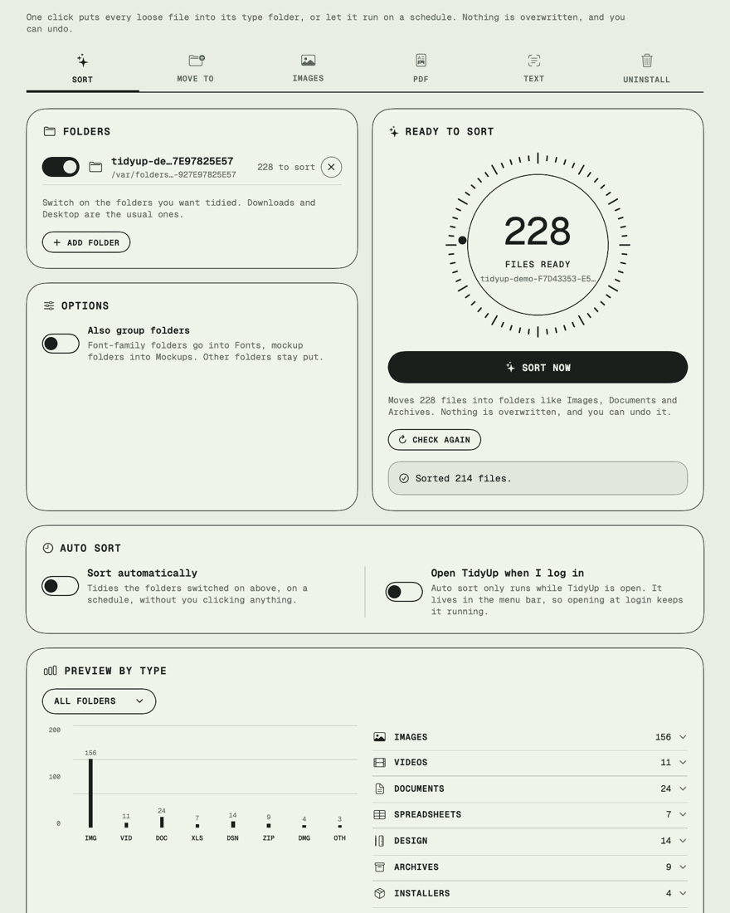

# TidyUp

One Mac app for tidying up: one-click file sorting plus a few everyday tools. Free, runs entirely on your Mac, and nothing is uploaded anywhere.



## Install

1. Download **TidyUp.dmg** from the [latest release](https://github.com/Vedant-Sakade/TidyUp/releases/latest).
2. Open it and drag **TidyUp** onto the **Applications** folder.
3. Open **Applications**, **right-click TidyUp, choose Open**, then click **Open** again.

Step 3 is only needed the first time. macOS asks because TidyUp isn't from the App Store, and it is not notarised by Apple. After that it opens normally.

Works on Apple Silicon and Intel Macs running macOS 14 (Sonoma) or newer.
If macOS still blocks it, go to System Settings > Privacy & Security and click **Open Anyway** next to TidyUp.

## What it does

- **Sort**: preview, then sort loose files into type folders; undo
- **Sort** also reads inside files with no extension (e.g. Instagram saves) to tell images, PDFs, videos and audio apart, and can optionally group font-family and mockup folders
- **Auto sort** (in the Sort tab): sort automatically daily or weekly, optionally open at login
- **Move to…**: favourite destination folders, drag files onto them
- **Images**: convert / compress / resize, optional metadata removal
- **PDF**: merge, split, delete pages, compress
- **Text from Screen**: copy text out of any screenshot (on-device OCR)
- **Uninstall Apps**: remove an app and its leftovers to the Trash

## Design

Sage paper background, thin ink outlines, rounded cards, pill buttons and Geist Mono type (SIL Open Font License, bundled in `Resources/Fonts`). A sun/moon switch in the header picks off-white or dark mode, and the choice is remembered. `TidyUp --render-preview <folder>` draws every screen to PNG for checking.

## Build it yourself

```bash
scripts/make_icon.sh   # only after changing the icon
scripts/build_app.sh --open   # universal app in build/TidyUp.app
scripts/make_dmg.sh           # also packs build/TidyUp.dmg
swift test      # engine + app-model + real-click control tests
```

Requires macOS 14+ and Xcode (or its command-line tools).
